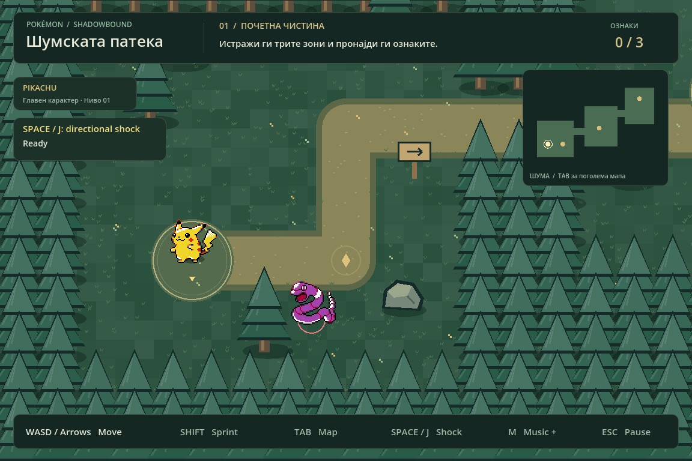

# Pokémon: Shadowbound — Шумската патека

**Godot 4.6.x · 2D top-down · Educational fan project**

Download this branch as a ZIP from **Code → Download ZIP**, extract it, import
`project.godot` in Godot 4.6.x Standard, and press **F5**. No Python, .NET,
plugins, or runtime downloads are required. Move with WASD/arrows, sprint with
Shift, hold Tab for the map, use Esc to pause, and Space/J for a directional shock.

GitHub Actions imports the project and runs all 51 physics, route, combat, camera, and restart checks on
pushes and pull requests. Generated `.godot` caches and exported ZIPs are excluded
from Git. See [asset credits](ASSET_CREDITS.md) for the supplied materials.


## Lab upgrade: camera, animation, enemies, and restart

- **Camera:** smooth Camera2D following, clamped to the 2304 × 1536 level. The camera never reveals space beyond the forest, including at the world corners.
- **Player animation:** procedural idle breathing, walking/running bounce and squash, left/right flipping, upward facing tint, and a four-direction facing indicator. Shock attacks have animated lightning and a distinct pose; death rotates and fades Pikachu.
- **Enemies:** three purple Ekans patrol independently in the clearing, forest passage, and sanctuary. Each is a reusable `scenes/enemy.tscn` CharacterBody2D with world collisions and a separate Area2D for contact detection. Defeated enemies spin and fade away.
- **Life and restart:** unprotected enemy contact makes Pikachu faint. Movement and attacks stop; after one second the entire scene reloads. Player position, collected markers, enemies, patrol positions, cooldowns, and pause state reset. **R** also performs a complete restart.
- **Bonus combat:** face an enemy and press **Space** or **J** to use an electric shock. It reaches 96 pixels in a forward cone, stays active for 0.28 seconds, and has a 0.65-second cooldown. A successful shock defeats the enemy before contact damage is resolved. Approaching from behind or attacking while recharging remains dangerous. Pause freezes enemy patrols and combat timers.

No extra assets, plugins, or runtime downloads are needed. Open `project.godot` with **Godot 4.6.3 Standard** and press **F5**.

Run both suites after importing assets:

```sh
godot --headless --editor --import --quit
godot --headless --script tests/test_forest.gd --fixed-fps 60
godot --headless --script tests/test_combat.gd --fixed-fps 60
```

The original suite has 19 checks; the new suite has 32 checks covering enemy movement, world collisions, pause, directional animations, attack range/cooldown/defeat, camera bounds, contact death, and actual automatic/manual scene reloads.

Готово top-down ниво за лабораториска вежба во **Godot 2D**, изработено со
материјалите од приложениот Python/Pygame проект. Ова е самостоен Godot проект
за изглед на ниво, главен карактер, движење и колизии; борбите и кампањата од
Python играта не се пренесени.



## Отворање и играње

1. Користете **Godot 4.6.x Standard** (проверено со 4.6.3); не треба .NET или Python.
2. Распакувајте ја целата папка, во Project Manager изберете **Import** и отворете
   `project.godot`.
3. Почекајте да заврши увозот на сликите и звукот. Притиснете **F6** за тековната
   сцена `scenes/forest.tscn` или **F5** за целиот проект.

„Godot 2D“ тука означува 2D проект во Godot 4, не старата верзија Godot 2.x.
Не се потребни дополнителни додатоци или преземања при играње.

| Копче | Дејство |
| --- | --- |
| WASD / стрелки | Движење во сите насоки |
| Shift | Трчање |
| Tab (држење) | Зголемена мапа |
| Esc | Пауза / продолжување |
| R | Враќање на почетната позиција и ресетирање на ознаките |
| M | Вклучување / исклучување на музиката |

Следете ја патеката од почетната чистина преку шумскиот премин до старото
светилиште. Соберете ги трите златни ознаки со приближување. Мапата ја покажува
позицијата на играчот и пронајдените ознаки.

## Барањата од вежбата

- **Цело top-down ниво:** мапа 2304 × 1536 со три јасни зони, две поврзувачки
  патеки, шумски граници, дрвја, карпи, паднати стебла и патокази.
- **Посебен главен карактер:** `scenes/player.tscn`, со `CharacterBody2D`,
  `Sprite2D`, кружна колизија кај стапалата и камера. Почеток: `(320, 1180)`.
- **Движење:** `scripts/player.gd` користи `Input.get_vector` и
  `move_and_slide()`. Дијагоналното движење е нормализирано. Има мала анимација
  само додека карактерот навистина се движи.
- **Колизии:** `StaticBody2D` и `CollisionShape2D` за сите шумски ѕидови и
  пречки. Околината е layer 1; играчот е layer 2 и проверува layer 1.
  Вклучете **Debug → Visible Collision Shapes** додека играта работи за проверка.
- **Приказ пред / зад објекти:** `World.y_sort_enabled = true`. Играчот и
  пречките се во истиот Y-сортиран родител; нивните почетни точки се кај
  основата. Крошните се над основата, па карактерот може да помине зад нив,
  а стеблата остануваат непреодни.
- **Материјали:** оригиналните Gen II Pokémon PNG-слики и `forest.wav` од
  приложениот ZIP. Белата надворешна позадина на sprite-от се отстранува во
  меморија со flood fill, без бришење на белите детали внатре. Шумската сценографија
  е преработена како Godot 2D цртање според стилот на приложениот проект.

Објектите и нивните колизии се зачувани во `forest.tscn` и се видливи и
поместливи во Godot уредникот. Подлогата е во `scripts/ground.gd`; UI и мапата
се во `scripts/hud.gd`. Копчињата се регистрираат во `scripts/forest.gd` при старт.

## Проверки

Од папката на проектот:

```sh
godot --headless --editor --import --quit
godot --headless --script tests/test_forest.gd
```

Автоматската проверка извршува вистинска физика: почетна позиција, транспарентна
позадина, Y-сортирање, нормализирана брзина, колизии со граница/дрво/карпа/стебло,
проодни премини, целата рута до сите три ознаки и запирање при пауза.
Резултат при изработка: **19 проверки, 0 неуспешни**. Направена е и визуелна
проверка со OpenGL Compatibility и зачувана слика во `docs/forest.png`.

Во cloud sandbox со недостапна домашна папка поставете ги овие директориуми
пред командите погоре (на сопствен компјутер тоа не е потребно):

```sh
mkdir -p /workspace/.godot-runtime/{cache,data,config}
export XDG_CACHE_HOME=/workspace/.godot-runtime/cache
export XDG_DATA_HOME=/workspace/.godot-runtime/data
export XDG_CONFIG_HOME=/workspace/.godot-runtime/config
```

## Потекло на материјалите

Pokémon sprites, имиња и дизајни припаѓаат на нивните носители на права.
Проектот е некомерцијална образовна fan-вежба. `assets/sprites/manifest.json`
ги задржува оригиналните извори, ревизија и SHA-256 на PNG-датотеките.
Музиката е оригинална синтетизирана композиција од приложениот проект.
`assets/SOURCE_NOTES.md` се непроменетите белешки од Python изворот и служат
како запис за потеклото, не како инструкции за стартување на Godot проектот.
